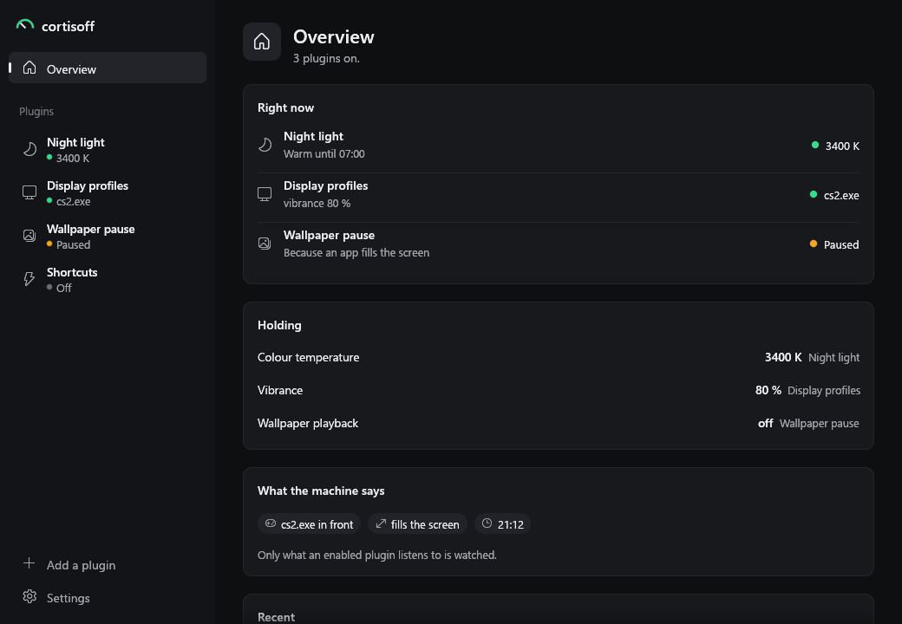
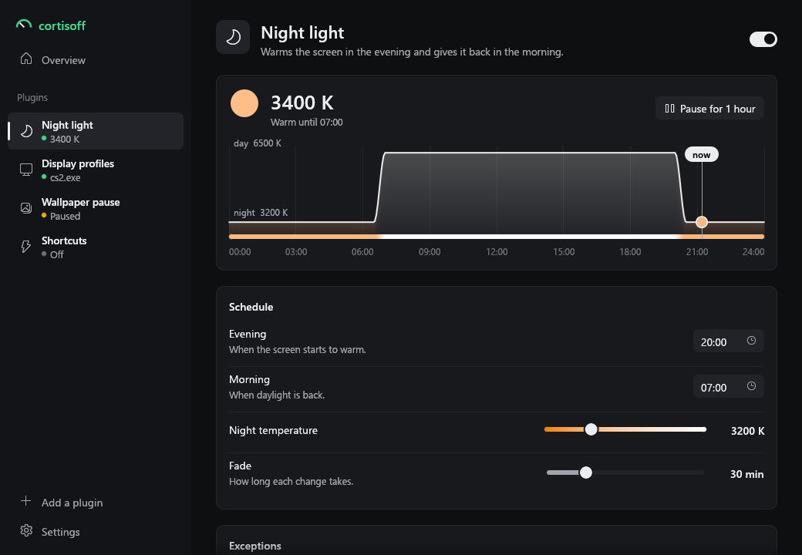
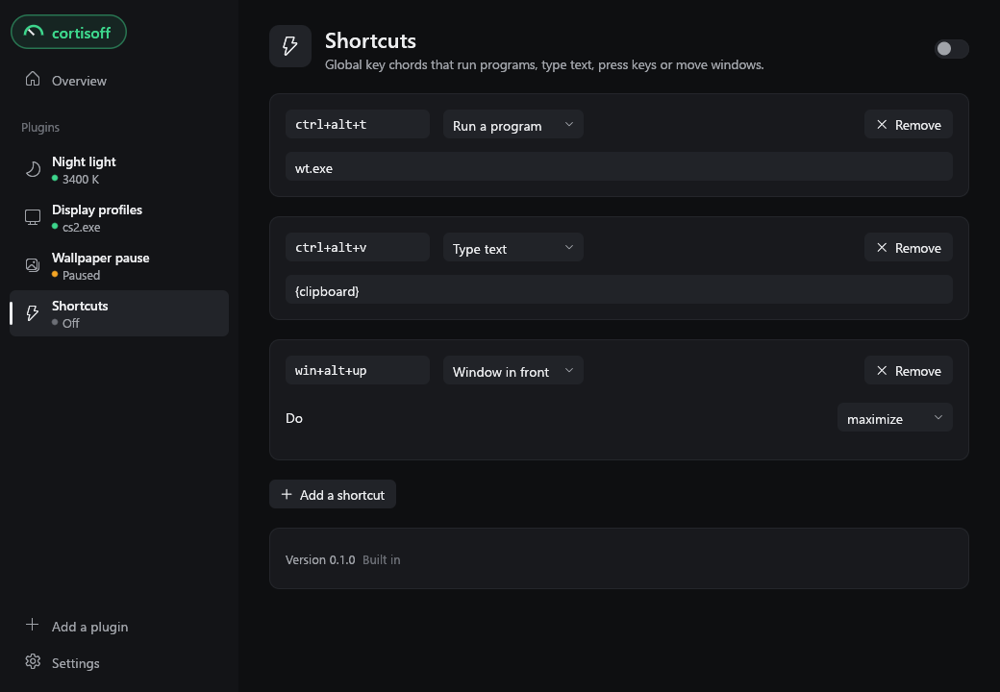

# cortisoff

[](https://github.com/klNuno/cortisoff/actions/workflows/ci.yml)
[](https://github.com/klNuno/cortisoff/releases/latest)
[](#license)

A small program that runs plugins on your desktop: a night light that warms the screen in the evening, a refresh rate and a vibrance for each game, an animated wallpaper that stops while nobody sees it, global shortcuts. Each plugin is a short Lua script you can read, change or write yourself.



## What it does

| Plugin | What it does |
| --- | --- |
| Night light | Warms the screen from the evening to the morning with a slow fade, and steps aside while a game or a film fills the screen or a listed app is in front. |
| Display profiles | Gives each app its own refresh rate and vibrance while it is in front, and puts yours back when it leaves. Vibrance needs an NVIDIA card. |
| Wallpaper pause | Stops Wallpaper Engine or Lively while an app fills the screen, while you are away or locked, or on battery. Windows only. |
| Shortcuts | Global key chords that start a program, type text, press other keys or move the window in front. |

Every plugin is off until you switch it on, and only what an enabled plugin asks about is watched.

Plugins never set a screen directly. They ask for a value (a colour temperature, a refresh rate) with a priority, cortisoff applies the strongest request, and when nothing asks any more it puts back exactly what was there before. Values that would survive a crash, such as a refresh rate, are written down before the first change, so even a power cut leaves nothing behind: the next start restores them.

<p>
  
  
</p>

## Install

Windows 10 and 11:

1. Download `cortisoff-windows-x86_64.exe` from the [latest release](https://github.com/klNuno/cortisoff/releases/latest).
2. Run it. It installs itself for your account only, with no administrator prompt, into `%LOCALAPPDATA%\Programs\Cortisoff`, adds a Start Menu entry and an entry in Settings > Apps, and starts with your session.

Closing the window leaves cortisoff running in the background; the window only shows and edits what it does. To remove it, use Uninstall in the settings page, or Settings > Apps. Your plugins and their settings stay, in case you come back.

Linux (X11) and macOS builds are on the same release page. They work but are less tested than Windows; expect rough edges, and please report them.

### Updates

An installed copy checks GitHub for a new release a couple of minutes after it starts and every six hours after that. Each release is signed, and a download whose signature does not match the key built into the app is thrown away. A verified update installs once no plugin is changing your screen, so a night tint never flickers in the middle of one. Switch "Install updates automatically" off in the settings page to install them yourself from there.

### Privacy

cortisoff collects nothing and sends nothing about you. It goes online for the update check and when you add a plugin from a link. A plugin you install can make its own web requests, so read it before you switch it on.

## Plugins

Add one from the window: "Add a plugin" takes a GitHub repository (`owner/repo` or its address) or a link to a zip.

A plugin is a folder with a `plugin.toml` and an `init.lua`. Its daemon half reacts to what happens on the machine and asks for values; its window half draws its own page with the same widgets as the built-in ones. The [plugin reference](docs/plugins.md) covers the whole API, and the [built-in plugins](plugins) are complete examples. While you work on one, `cortisoff-cli link <folder>` loads it in place and reloads it every time you save.

## Command line

`cortisoff-cli` talks to the running daemon. It is a separate download on the release page; put it next to `cortisoff` before the first start and the installer copies it alongside the app.

```text
cortisoff-cli plugins                 every plugin, on or off
cortisoff-cli enable <id>             switch a plugin on
cortisoff-cli disable <id>            switch it off, releasing everything it holds
cortisoff-cli settings <id> [json]    print a plugin's settings, or replace them
cortisoff-cli link <folder>           load a plugin from a folder, reloaded on save
cortisoff-cli state                   the live state: every plugin, who holds what
cortisoff-cli trace                   everything the daemon sees and does, live
cortisoff-cli doctor                  what this machine can do, and what it cannot
cortisoff-cli set <cap> <value>       a manual override, above every plugin
cortisoff-cli clear <cap>             drop the override
cortisoff-cli start | stop            start the daemon, or stop it and restore everything
cortisoff-cli update                  whether a new version is out
cortisoff-cli update auto <on|off>    install new versions on its own, or not
```

`cortisoff-cli` with no argument lists every command.

## Platforms

| | Windows | Linux | macOS |
| --- | --- | --- | --- |
| Colour temperature | yes | X11 | yes |
| Refresh rate | yes | X11 | yes |
| Vibrance | NVIDIA | no | no |
| Animated wallpaper | Wallpaper Engine, Lively | no | no |
| Shortcuts | yes | X11 | yes |
| Install and updates | yes | yes | yes |

`cortisoff-cli doctor` prints what your own machine supports, and each plugin's page says when something it needs is missing.

## Building

```sh
cargo run -p cortisoff-app               # the window, which starts a daemon if none runs
cargo test --workspace
```

Linux needs a few system packages first. Everything else, from the layout of the code to the checks a pull request goes through, is in [CONTRIBUTING.md](CONTRIBUTING.md).

## License

Licensed under either of [Apache License, Version 2.0](LICENSE-APACHE) or [MIT license](LICENSE-MIT), at your option.

Unless you explicitly state otherwise, any contribution intentionally submitted for inclusion in cortisoff by you, as defined in the Apache-2.0 license, shall be dual licensed as above, without any additional terms or conditions.
